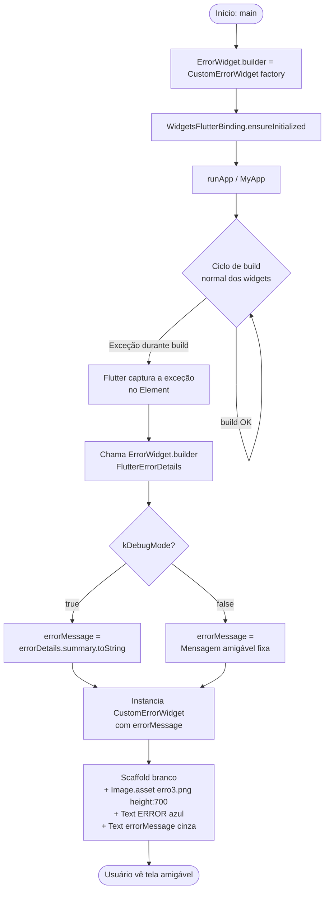

# Tela de Erro Customizada (Custom Error Widget)

> **Classificação para o Template Corporativo:** 🟢 Reutilizar com melhorias  
> **Valor:** ALTO — elimina a tela vermelha padrão do Flutter em produção, substituindo-a por uma tela amigável com identidade visual do produto.

---

## 1. Visão Geral e Valor da Funcionalidade

O Flutter exibe, por padrão, uma tela completamente vermelha com texto técnico branco sempre que ocorre um erro durante a construção (`build`) de um widget. Esse comportamento é adequado durante o desenvolvimento, mas é altamente indesejável em produção: expõe detalhes internos da aplicação, assusta o usuário e prejudica a percepção de qualidade do produto.

O projeto **controle_separacao_aplicativo** substitui esse comportamento padrão por uma tela amigável que exibe:

- Uma imagem ilustrativa (`assets/img/erro3.png`) que comunica visualmente a situação de erro sem gerar ansiedade;
- Um título `ERROR` estilizado;
- Uma mensagem de texto cujo conteúdo varia conforme o ambiente:
  - **Debug:** exibe o resumo técnico do erro (`FlutterErrorDetails.summary`), auxiliando o desenvolvedor a identificar o problema sem precisar checar o console;
  - **Release:** exibe uma mensagem amigável e genérica, orientando o usuário a contatar o suporte.

A implementação é mínima (um único widget + quatro linhas no `main.dart`), sem dependências externas além do próprio Flutter SDK, e pode ser copiada integralmente para qualquer projeto Flutter.

---

## 2. Arquivos Envolvidos

| Arquivo | Papel |
|---|---|
| `lib/main.dart` (linhas 54–61) | Ponto de registro global: atribui `ErrorWidget.builder` antes de `runApp`, interceptando todos os erros de build de widgets em toda a aplicação. |
| `lib/src/components/custom_error_widget.dart` | Define `CustomErrorWidget`, o widget `StatelessWidget` que renderiza a tela amigável (imagem + título + mensagem). |
| `pubspec.yaml` (linha 103) | Declara o diretório `assets/img/` como asset do projeto, tornando `erro3.png` acessível via `Image.asset`. |
| `assets/img/erro3.png` | Imagem ilustrativa exibida na tela de erro (arquivo PNG, ~1,17 MB, presente em `assets/img/`). |

---

## 3. Classes e Símbolos Envolvidos

### `CustomErrorWidget`

- **Arquivo:** `lib/src/components/custom_error_widget.dart`
- **Tipo:** `StatelessWidget`
- **Parâmetros do construtor:**

  | Parâmetro | Tipo | Obrigatório | Descrição |
  |---|---|---|---|
  | `errorMessage` | `String` | Sim | Mensagem exibida abaixo do título. Determinada pelo chamador com base em `kDebugMode`. |

- **Estrutura interna:**

  ```
  Scaffold
  └── Center
      └── Padding(all: 16.0)
          └── Column(mainAxisAlignment: center)
              ├── Image.asset('assets/img/erro3.png', height: 700, fit: BoxFit.contain)
              ├── SizedBox(height: 24)
              ├── Text('ERROR', fontSize: 32, bold, color: Colors.blueAccent)
              ├── SizedBox(height: 16)
              └── Text(errorMessage, fontSize: 16, color: Colors.black54, textAlign: center)
  ```

---

### `ErrorWidget.builder`

- **Tipo:** `ErrorWidgetBuilder` — um `typedef` do Flutter: `Widget Function(FlutterErrorDetails details)`
- **Natureza:** propriedade estática global da classe `ErrorWidget` (pacote `flutter/widgets.dart`).
- **Comportamento padrão:** retorna um widget vermelho sólido com a mensagem de erro em branco.
- **Comportamento após a substituição:** retorna a instância de `CustomErrorWidget` fornecida pelo projeto.
- **Quando é invocado:** toda vez que o mecanismo de renderização do Flutter (`RenderObject`/`Element`) captura uma exceção durante a fase de **build** de um widget e precisa exibir um widget substituto no lugar do widget que falhou.
- **Escopo completo:** é chamado dentro da árvore de widgets, no contexto do `Element` que falhou. O widget retornado ocupa o espaço que seria do widget original.

---

### `FlutterErrorDetails`

- **Pacote:** `flutter/foundation.dart`
- **O que é:** objeto que encapsula todas as informações disponíveis sobre um erro capturado pelo framework Flutter.
- **Propriedades relevantes usadas no projeto:**

  | Propriedade | Tipo | Uso no projeto |
  |---|---|---|
  | `summary` | `DiagnosticsNode` | Chamado via `.toString()` para obter o resumo textual do erro em modo debug. |

- **Outras propriedades disponíveis (não usadas, mas documentadas para referência):**

  | Propriedade | Tipo | Descrição |
  |---|---|---|
  | `exception` | `Object` | A exceção original lançada. |
  | `stack` | `StackTrace?` | Stack trace completo. |
  | `library` | `String?` | Nome da biblioteca onde o erro ocorreu. |
  | `context` | `DiagnosticsNode?` | Contexto descritivo adicional. |

---

### `kDebugMode`

- **Pacote:** `flutter/foundation.dart`
- **Tipo:** `bool` — constante de tempo de compilação.
- **Valor em debug:** `true` (builds com `flutter run` ou `flutter build --debug`).
- **Valor em release/profile:** `false` (builds com `flutter build apk/ios/web` sem flag `--debug`).
- **Como o compilador trata:** por ser `const`, o compilador Dart (com tree-shaking ativo em release) elimina o branch `true` do código compilado em release, tornando a separação de comportamentos segura e eficiente.

---

## 4. Fluxo de Execução Completo

### Passo a Passo Narrativo

1. **Inicialização da aplicação** — `main()` é chamado pelo runtime Dart.
2. **Registro do builder** — Antes de qualquer outra chamada (inclusive `WidgetsFlutterBinding.ensureInitialized()`), a linha abaixo substitui o `ErrorWidget.builder` global:
   ```dart
   ErrorWidget.builder = (FlutterErrorDetails errorDetails) {
     return CustomErrorWidget(
       errorMessage: kDebugMode
           ? errorDetails.summary.toString()
           : 'Ocorreu um erro inesperado. Por favor, entre em contato com o suporte.',
     );
   };
   ```
3. **Aplicação em execução normal** — Os widgets são construídos normalmente. O builder registrado permanece em standby.
4. **Ocorrência do erro** — Durante a fase de `build` de algum widget, uma exceção é lançada (ex.: `NullPointerException`, acesso a índice inválido, tipo incompatível em cast, etc.).
5. **Captura pelo framework** — O `Element` que estava construindo o widget captura a exceção internamente e chama `ErrorWidget.builder(errorDetails)`.
6. **Decisão de conteúdo** — Dentro do builder registrado, `kDebugMode` é avaliado:
   - `true` → `errorMessage = errorDetails.summary.toString()` (resumo técnico)
   - `false` → `errorMessage = 'Ocorreu um erro inesperado. Por favor, entre em contato com o suporte.'`
7. **Instanciação do CustomErrorWidget** — O builder retorna uma nova instância de `CustomErrorWidget` com a `errorMessage` determinada no passo anterior.
8. **Renderização da tela amigável** — O Flutter insere o `CustomErrorWidget` no lugar do widget que falhou. O `Scaffold` com fundo branco, a imagem `erro3.png`, o título `ERROR` azul e a mensagem de texto são exibidos ao usuário.

---

### Diagrama de Fluxo (Mermaid)



---

## 5. Como o Erro é Capturado — Escopo e Limites

### O que `ErrorWidget.builder` captura

`ErrorWidget.builder` é acionado **exclusivamente para erros ocorridos durante a fase de `build` de widgets** — isto é, dentro de métodos `build()` que são executados pelo mecanismo de renderização do Flutter (`RenderObjectElement`, `StatelessElement`, `StatefulElement`, etc.).

Exemplos de erros capturados:
- `Null check operator used on a null value` dentro de um `build()`;
- `RangeError` ao acessar um índice de lista dentro de um `build()`;
- `CastError` / `TypeError` em cast explícito dentro de um `build()`;
- Qualquer exceção não tratada lançada sincronamente durante a construção da árvore de widgets.

### O que `ErrorWidget.builder` NÃO captura

> **Nota informativa de escopo:** os tipos de erro abaixo existem no projeto e são independentes do mecanismo de `ErrorWidget.builder`. Esta seção documenta apenas os limites do mecanismo, sem sugerir alterações.

| Tipo de erro | Mecanismo responsável | Observação |
|---|---|---|
| Exceções assíncronas não tratadas (Future, async/await fora de build) | `FlutterError.onError` + zona Dart | Podem ser capturadas com `runZonedGuarded` e `FlutterError.onError`. |
| Erros em callbacks de `GestureDetector`, `onPressed`, etc. | Zona Dart padrão | São propagados para a zona e não para o `ErrorWidget.builder`. |
| Erros de inicialização antes de `runApp` | Stack trace no console/logcat | Ocorrem antes que o framework de widgets esteja ativo. |
| Exceções em isolates secundários | Mecanismo de isolate Dart | Completamente separados da árvore de widgets. |

---

### Comportamento Debug vs. Release

| Aspecto | Debug (`kDebugMode = true`) | Release (`kDebugMode = false`) |
|---|---|---|
| Mensagem exibida | `errorDetails.summary.toString()` — resumo técnico gerado pelo Flutter, ex.: `"The following assertion was thrown building MyWidget: ..."` | `'Ocorreu um erro inesperado. Por favor, entre em contato com o suporte.'` |
| Utilidade | Desenvolvedor identifica o widget e a causa sem abrir o console | Usuário final recebe mensagem compreensível sem exposição de detalhes técnicos |
| Risco de exposição | Aceitável (somente em builds de desenvolvimento) | Nenhum (mensagem fixa e genérica) |

---

## 6. Estrutura da Tela Amigável

### Código Real do Widget

```dart
// lib/src/components/custom_error_widget.dart

import 'package:flutter/material.dart';

class CustomErrorWidget extends StatelessWidget {
  final String errorMessage; // Mensagem do erro (modo debug ou release)

  const CustomErrorWidget({
    Key? key,
    required this.errorMessage,
  }) : super(key: key);

  @override
  Widget build(BuildContext context) {
    return Scaffold(
      backgroundColor: Color(0xFFFFFFFF),
      body: Center(
        child: Padding(
          padding: const EdgeInsets.all(16.0),
          child: Column(
            mainAxisAlignment: MainAxisAlignment.center,
            children: [
              Image.asset(
                'assets/img/erro3.png',
                height: 700,
                fit: BoxFit.contain,
              ),
              const SizedBox(height: 24),
              Text(
                'ERROR',
                style: TextStyle(
                  fontSize: 32,
                  fontWeight: FontWeight.bold,
                  color: Colors.blueAccent,
                ),
              ),
              const SizedBox(height: 16),
              Text(
                errorMessage,
                textAlign: TextAlign.center,
                style: TextStyle(
                  fontSize: 16,
                  color: Colors.black54,
                ),
              ),
            ],
          ),
        ),
      ),
    );
  }
}
```

### Detalhamento dos Estilos

| Elemento | Propriedade | Valor |
|---|---|---|
| `Scaffold.backgroundColor` | Cor de fundo | `Color(0xFFFFFFFF)` — branco puro |
| `Padding` | Espaçamento interno | `EdgeInsets.all(16.0)` — 16 dp em todos os lados |
| `Column.mainAxisAlignment` | Alinhamento vertical | `MainAxisAlignment.center` — centralizado verticalmente |
| `Image.asset` | Caminho | `'assets/img/erro3.png'` |
| `Image.asset` | Altura | `700` pixels lógicos (dp) |
| `Image.asset` | Ajuste | `BoxFit.contain` — preserva proporção sem cortar |
| `SizedBox` (após imagem) | Espaçamento | `24` dp |
| `Text` "ERROR" | Tamanho da fonte | `32` |
| `Text` "ERROR" | Peso | `FontWeight.bold` |
| `Text` "ERROR" | Cor | `Colors.blueAccent` |
| `SizedBox` (após título) | Espaçamento | `16` dp |
| `Text` errorMessage | Tamanho da fonte | `16` |
| `Text` errorMessage | Cor | `Colors.black54` |
| `Text` errorMessage | Alinhamento | `TextAlign.center` |

### Asset

- **Arquivo:** `assets/img/erro3.png`
- **Tamanho no disco:** aproximadamente 1,17 MB
- **Declaração no `pubspec.yaml`:**

```yaml
flutter:
  assets:
    - assets/img/
```

A declaração do diretório inteiro (`assets/img/`) inclui automaticamente todos os arquivos presentes nele, incluindo `erro3.png`.

---

## 7. Como Reutilizar em Outro Projeto — Passo a Passo

### Pré-requisito

Ter um projeto Flutter funcional com estrutura padrão (`lib/`, `assets/`, `pubspec.yaml`).

---

### Passo 1 — Copiar o widget

Copie o arquivo abaixo integralmente para o novo projeto:

**Origem:** `lib/src/components/custom_error_widget.dart`  
**Destino sugerido:** `lib/src/components/custom_error_widget.dart` (ou qualquer caminho dentro de `lib/`)

Nenhuma alteração é necessária para funcionamento básico.

---

### Passo 2 — Copiar a imagem

Copie o arquivo de imagem para o novo projeto:

**Origem:** `assets/img/erro3.png`  
**Destino:** `assets/img/erro3.png` (ou outro caminho — ajustar no Passo 4)

Se o projeto novo usar uma imagem diferente, substitua o arquivo e atualize o caminho no widget (propriedade `Image.asset`, primeira posição).

---

### Passo 3 — Declarar o asset no `pubspec.yaml`

No arquivo `pubspec.yaml` do novo projeto, localize a seção `flutter:` e adicione (ou complemente) a entrada `assets:`:

```yaml
flutter:
  uses-material-design: true
  assets:
    - assets/img/   # inclui erro3.png e todos os demais arquivos da pasta
```

Salve o arquivo e execute `flutter pub get` para que o Flutter reconheça o novo asset.

---

### Passo 4 — Registrar o builder no `main.dart`

No `main()` do novo projeto, **antes de qualquer outra chamada** (inclusive `WidgetsFlutterBinding.ensureInitialized()`), adicione:

```dart
import 'package:flutter/foundation.dart'; // kDebugMode
import 'package:flutter/material.dart';
import 'src/components/custom_error_widget.dart'; // ajuste o caminho se necessário

void main() async {
  // Substituição da tela vermelha padrão do Flutter
  ErrorWidget.builder = (FlutterErrorDetails errorDetails) {
    return CustomErrorWidget(
      errorMessage: kDebugMode
          ? errorDetails.summary.toString()
          : 'Ocorreu um erro inesperado. Por favor, entre em contato com o suporte.',
    );
  };

  WidgetsFlutterBinding.ensureInitialized();
  // ... restante da inicialização
  runApp(const MyApp());
}
```

> **Importante:** o registro deve ocorrer antes de `runApp` e, idealmente, antes de `WidgetsFlutterBinding.ensureInitialized()`, para garantir que qualquer erro na própria inicialização também seja interceptado.

---

### Passo 5 — Verificar o funcionamento

Para testar sem esperar um erro real de produção, adicione temporariamente um widget que lança exceção:

```dart
// Widget de teste — REMOVER após verificação
class _WidgetQueLancaErro extends StatelessWidget {
  @override
  Widget build(BuildContext context) {
    throw Exception('Teste de CustomErrorWidget');
  }
}
```

Adicione esse widget em qualquer parte da árvore e execute a aplicação. A tela amigável deve aparecer no lugar do widget, tanto em debug (com o resumo da exceção) quanto em release (com a mensagem genérica, se buildar com `--release`).

Remova o widget de teste após a verificação.

---

## 8. Checklist de Configuração em Projeto Novo

```
[ ] 1. Arquivo custom_error_widget.dart copiado para lib/src/components/ (ou caminho equivalente)
[ ] 2. Imagem de erro copiada para assets/img/erro3.png (ou caminho alternativo definido)
[ ] 3. pubspec.yaml: seção flutter > assets inclui o diretório da imagem
[ ] 4. flutter pub get executado após atualização do pubspec.yaml
[ ] 5. main.dart: ErrorWidget.builder atribuído antes de WidgetsFlutterBinding.ensureInitialized()
[ ] 6. Import de flutter/foundation.dart (kDebugMode) presente no main.dart
[ ] 7. Import do custom_error_widget.dart presente no main.dart
[ ] 8. Mensagem de produção revisada e aprovada pelo time (atualmente: 'Ocorreu um erro inesperado...')
[ ] 9. Cor do título 'ERROR' verificada contra a identidade visual do produto (atualmente: Colors.blueAccent)
[ ] 10. Imagem verificada em dispositivos de tela pequena (altura fixa de 700 pode ser ajustada — ver Seção 9)
[ ] 11. Teste manual executado com widget que lança exceção (debug e release)
[ ] 12. Widget de teste removido antes do merge/release
```

---

## 9. Melhorias Possíveis Sem Alterar o Comportamento Atual

> As sugestões abaixo são **totalmente opcionais e retrocompatíveis**. Cada uma pode ser adotada de forma independente, e nenhuma altera o comportamento visível do widget quando os valores padrão são mantidos iguais aos atuais.

---

### 9.1 Tornar imagem, altura e mensagem parametrizáveis

Adicionar parâmetros opcionais com valores padrão idênticos aos atuais. O construtor existente continua funcional sem alteração nos chamadores.

```dart
class CustomErrorWidget extends StatelessWidget {
  final String errorMessage;
  final String imagePath;        // padrão: valor atual
  final double imageHeight;      // padrão: 700
  final Color titleColor;        // padrão: Colors.blueAccent
  final String titleText;        // padrão: 'ERROR'

  const CustomErrorWidget({
    Key? key,
    required this.errorMessage,
    this.imagePath = 'assets/img/erro3.png',
    this.imageHeight = 700,
    this.titleColor = Colors.blueAccent,
    this.titleText = 'ERROR',
  }) : super(key: key);

  // ... build sem alteração lógica, usando os parâmetros acima
}
```

Benefício: permite que diferentes projetos que reutilizem o widget utilizem suas próprias imagens e cores de marca sem precisar editar o arquivo do widget.

---

### 9.2 Usar `MediaQuery` para adaptar a altura da imagem a telas pequenas

A altura fixa de `700` dp pode ultrapassar a altura disponível em dispositivos com telas pequenas (ex.: 480 dp de altura útil), causando overflow. Uma alternativa retrocompatível:

```dart
// Dentro de build(BuildContext context):
final double screenHeight = MediaQuery.of(context).size.height;
final double imageHeight = screenHeight * 0.65; // ~65% da altura disponível

Image.asset(
  imagePath,
  height: imageHeight,
  fit: BoxFit.contain,
),
```

Com `screenHeight * 0.65`, em uma tela de 1080 dp a imagem teria 702 dp (praticamente igual ao atual); em telas menores, seria reduzida proporcionalmente. O valor `0.65` pode ser também parametrizado (ver 9.1).

---

### 9.3 Extrair textos para constantes ou internacionalização

O título `'ERROR'` e a mensagem de release são strings literais inline. Extraí-las para constantes ou para o sistema de i18n do projeto facilita manutenção e tradução:

```dart
// Em um arquivo de constantes do projeto, ex.: lib/src/constants/app_strings.dart
abstract class AppStrings {
  static const String errorTitle = 'ERROR';
  static const String errorMessageRelease =
      'Ocorreu um erro inesperado. Por favor, entre em contato com o suporte.';
}
```

---

### 9.4 Callback opcional de "reportar erro"

Permitir que o chamador forneça um callback opcional chamado quando o usuário toca um botão "Reportar", sem obrigar sua presença:

```dart
class CustomErrorWidget extends StatelessWidget {
  final String errorMessage;
  final VoidCallback? onReport; // opcional, nulo por padrão — sem quebra de compatibilidade

  const CustomErrorWidget({
    Key? key,
    required this.errorMessage,
    this.onReport,
  }) : super(key: key);

  @override
  Widget build(BuildContext context) {
    return Scaffold(
      // ... estrutura atual ...
      // Adicionar condicionalmente:
      // if (onReport != null)
      //   ElevatedButton(onPressed: onReport, child: Text('Reportar'))
    );
  }
}
```

Quando `onReport` é `null` (comportamento padrão, igual ao atual), o botão não é renderizado.

---

## 10. Classificação para o Template Corporativo

### 🟢 Reutilizar com melhorias

**Justificativa:**

A funcionalidade está correta, é estável e resolve um problema real de experiência do usuário presente em qualquer aplicação Flutter em produção. O código é mínimo, sem dependências externas, e o ponto de integração (`ErrorWidget.builder` no `main.dart`) é padronizado pelo próprio Flutter SDK.

A classificação é **"com melhorias"** (e não apenas "reutilizar") pelos seguintes motivos objetivos:

1. **Altura fixa de 700 dp** pode causar overflow visual em dispositivos com telas menores — um risco real para aplicações corporativas que rodam em coletores de dados, tablets pequenos ou smartphones de entrada.
2. **Parâmetros hardcoded** (caminho da imagem, cor do título, texto "ERROR") tornam o widget menos portável: cada projeto que reutilizar precisará editar o arquivo internamente em vez de configurar via construtor.
3. **Texto inline no `main.dart`** torna a mensagem de release invisível ao sistema de i18n e dificulta revisão de conteúdo por times de produto.

As melhorias descritas na Seção 9 são retrocompatíveis e podem ser aplicadas de forma incremental, sem risco de quebra de comportamento.

---

## Referências

- [Flutter — ErrorWidget class](https://api.flutter.dev/flutter/widgets/ErrorWidget-class.html)
- [Flutter — ErrorWidget.builder](https://api.flutter.dev/flutter/widgets/ErrorWidget/builder.html)
- [Flutter — FlutterErrorDetails class](https://api.flutter.dev/flutter/foundation/FlutterErrorDetails-class.html)
- [Dart — kDebugMode constant](https://api.flutter.dev/flutter/foundation/kDebugMode-constant.html)

---

*Documento gerado em 2026-06-24 a partir da leitura direta do código-fonte do projeto controle_separacao_aplicativo (somente leitura). Todos os trechos de código são reais e extraídos dos arquivos originais.*
