# Catálogo Profundo de Bibliotecas — controle_separacao_aplicativo

> **Postura de documentação:** Este catálogo registra fielmente o que existe e funciona em produção. A stack atual é a fundação a preservar. Recomendações de substituição ou modernização NÃO fazem parte deste documento; riscos de manutenção futura aparecem somente em blocos "Consideração futura (não aplicar agora)".

**Versões de ambiente resolvidas** (extraídas de `pubspec.lock`):

```
sdk:     dart >=3.5.3 <4.0.0
flutter: >=3.24.0
```

---

## Tabela Mestre

| Biblioteca | Versão declarada | Versão resolvida | Finalidade | Onde (resumo) | Dependências internas | Classificação |
|---|---|---|---|---|---|---|
| cupertino_icons | ^1.0.8 | 1.0.8 | Fonte de ícones iOS estilo CupertinoIcons | (transitiva via flutter SDK — não importada diretamente no código Dart) | flutter SDK | ✅ Reutilizar |
| mask_text_input_formatter | ^2.9.0 | 2.9.0 | Máscara de entrada de texto (ex.: lote/corrida) | `pages/conferir_material_entrada/view/conferir_material_entrada.dart` (legado) | — | ✅ Reutilizar |
| get | ^4.6.6 | 4.7.2 | Framework de DI, estado reativo e navegação | `main.dart`, todos controllers, views e rotas | — (fundação) | ✅ Reutilizar |
| dio | ^5.7.0 | 5.8.0+1 | Cliente HTTP; chamadas REST à API backend | `core/services/http_manager.dart` | get (via HttpManager) | ✅ Reutilizar |
| intl | ^0.19.0 | 0.19.0 | Formatação de datas e moedas pt_BR | `core/utils/formatar_valores.dart`, `core/services/log_services.dart` | — | ✅ Reutilizar |
| json_annotation | ^4.4.0 | 4.9.0 | Anotações para serialização JSON | Declarada mas modelos usam fromJson/toJson manuais | — | ✅ Reutilizar |
| tab_container | ^3.5.3 | 3.5.3 | Widget de abas com animação personalizada | `core/features/nfs_pedidos/view/nfs_pedidos.dart` | get (Obx) | ✅ Reutilizar |
| image_picker | ^1.1.2 | 1.1.2 | Captura de fotos via câmera do dispositivo | `core/features/conferir_material_entrada/controller/…` | — | ✅ Reutilizar |
| barcode_scan2 | ^4.3.3 | 4.5.1 | Leitura de código de barras/QR via câmera | `core/features/conferir_material_saida/controller/…` | — | ✅ Reutilizar |
| fluttertoast | ^8.2.8 | 8.2.12 | Toasts nativos (declarada; importada no utils_services) | `core/utils/utils_services.dart` (import presente, classe vazia) | — | ✅ Reutilizar |
| logger | ^2.5.0 | 2.5.0 | Log estruturado em console (debug/info/warn/error) | `core/services/log_services.dart`, `core/services/http_manager.dart` | — | ✅ Reutilizar |
| hive | ^2.2.3 | 2.2.3 | Banco de dados NoSQL local (cache offline) | `core/services/Hive_services.dart`, `main.dart` | hive_flutter | ✅ Reutilizar |
| hive_flutter | ^1.1.0 | 1.1.0 | Inicialização do Hive no Flutter (path_provider) | `main.dart` (`Hive.initFlutter()`) | hive | ✅ Reutilizar |
| oktoast | ^3.4.0 | 3.4.0 | Toasts customizados em overlay Flutter puro | `components/custom_toast.dart`, `main.dart` (OKToast wrapper) | — | ✅ Reutilizar |
| flutter_speed_dial | ^7.0.0 | 7.0.0 | FAB expansível (menu de ações flutuantes) | `core/features/conferir_material_saida/view/conferir_material_saida.dart` | — | ✅ Reutilizar |
| pluto_grid | ^8.0.0 | 8.0.0 | DataGrid avançado (filtros, paginação, agrupamento) | `components/custom_plutoGrid_Table.dart`, `core/features/nfs_pedidos/view/nfs_pedidos.dart` | get (Obx/RxList) | ✅ Reutilizar |
| **Dev** | | | | | | |
| flutter_launcher_icons | ^0.13.1 | 0.13.1 | Geração de ícones do app por plataforma | `pubspec.yaml` (configuração) — build-time only | — | ✅ Reutilizar |
| test | ^1.25.7 | 1.25.7 | Framework de testes Dart | Infra de testes (nenhum teste encontrado no projeto ainda) | — | ✅ Reutilizar |
| flutter_lints | ^4.0.0 | (via flutter_test SDK) | Regras de lint recomendadas | `analysis_options.yaml` | — | ✅ Reutilizar |

---

## Subseções por Biblioteca

---

### 1. cupertino_icons

#### Finalidade no projeto
Fornece a fonte de ícones no estilo iOS (`CupertinoIcons.*`). É exigida como dependência pelo template padrão Flutter. No projeto atual o uso direto é via `Icon(Icons.*)` do Material; os ícones Cupertino ficam disponíveis mas não foram encontrados imports diretos no código Dart.

#### Onde é usada
- Declarada em `pubspec.yaml` (padrão Flutter).
- A fonte é embutida no bundle do app automaticamente.

#### Como é usada
Uso indireto: Flutter SDK referencia o pacote internamente quando `uses-material-design: true`.

#### Versões
| Campo | Valor |
|---|---|
| Declarada | `^1.0.8` |
| Resolvida | `1.0.8` |

#### Dependências entre bibliotecas
Depende apenas do Flutter SDK.

#### Impacto de atualização
Somente mudanças de glifos na fonte; sem quebra de API.

#### Classificação
✅ **Reutilizar** — dependência obrigatória do template Flutter padrão; sem custo de manutenção.

---

### 2. mask_text_input_formatter

#### Finalidade no projeto
Aplicação de máscara de entrada em campos de formulário (ex.: campo lote/corrida com caracteres alfanuméricos limitados).

#### Onde é usada
- `lib/src/pages/conferir_material_entrada/view/conferir_material_entrada.dart` (código legado da pasta `pages/`)

#### Como é usada
```dart
import 'package:mask_text_input_formatter/mask_text_input_formatter.dart';

// O arquivo importa o pacote; o uso ativo encontrado no código legado
// é o inputFormatters: [...] passado ao CustomTextField
```

> **Nota:** Na camada `core/` refatorada, o mesmo campo usa `FilteringTextInputFormatter` nativo do Flutter SDK, sem dependência externa. O arquivo legado que importa `mask_text_input_formatter` ainda está presente.

#### Versões
| Campo | Valor |
|---|---|
| Declarada | `^2.9.0` |
| Resolvida | `2.9.0` |

#### Dependências entre bibliotecas
Nenhuma dependência cruzada com outras libs do projeto.

#### Impacto de atualização
Major v3 (caso ocorra) pode mudar a API de `MaskTextInputFormatter`; impacto mínimo por ser um ponto único de uso.

#### Compatibilidade futura
Compatível com Dart 3 e Flutter 3.24+; sem issues conhecidos.

#### Classificação
✅ **Reutilizar** — em produção no código legado; mantida na declaração do projeto.

> **Consideração futura (não aplicar agora):** A camada `core/` já substitui o formatter por `FilteringTextInputFormatter` nativo. Em eventual refatoração do código legado (`pages/`) poder-se-ia remover esta dependência.

---

### 3. get (GetX)

#### Finalidade no projeto
Pilar principal da arquitetura: injeção de dependência, gerenciamento de estado reativo (`Rx`, `Obx`) e navegação declarativa (`GetMaterialApp`, `GetPage`, `Get.toNamed`, `Get.back`, `Get.find`, `Get.put`).

#### Onde é usada
Praticamente todos os arquivos Dart do projeto importam `package:get/get.dart`. Arquivos-chave:

- `lib/main.dart` — bootstrapping de DI (`Get.put`) e `GetMaterialApp`
- `lib/src/routes/app_pages.dart` — definição das rotas (`GetPage`)
- Todos os controllers em `core/features/*/controller/`
- Todas as views que lêem estado (`Obx(() => ...)`)
- `core/services/http_manager.dart` — `Get.find<HiveServicesInterface>()`

#### Como é usada
```dart
// main.dart — DI e app root
Get.put<LoginControllerInterface>(LoginController());
runApp(OKToast(child: GetMaterialApp(
  initialRoute: PagesRoutes.splashScreen.path,
  getPages: AppPages.pages,
)));

// controller — estado reativo
RxList<NotaCompraLotesEtiquetas> NotaCompraLotes = <NotaCompraLotesEtiquetas>[].obs;

// view — reatividade
Obx(() => Text(formatarValor.formatvalueToBrasil(controller.totalPesoLiq.value)));

// navegação
Get.offAllNamed(PagesRoutes.login.path);
Get.back();
```

#### Versões
| Campo | Valor |
|---|---|
| Declarada | `^4.6.6` |
| Resolvida | `4.7.2` |

#### Dependências entre bibliotecas
GetX é a fundação; quase todas as outras libs interagem indiretamente via DI (`Get.find`). Dependências que usam GetX:
- `http_manager.dart` → `Get.find<HiveServicesInterface>()`
- `log_services.dart` → `Get.find<LoadingController>()`
- `hive_services.dart` → `Get.find<UtilsServicesInterfaces>()`

#### Impacto de atualização
GetX v5 (em desenvolvimento na comunidade) mudaria a API de rotas e controladores. É a atualização de maior impacto no projeto.

#### Compatibilidade futura
GetX 4.x é compatível com Dart 3 e Flutter 3.24+.

#### Classificação
✅ **Reutilizar** — é a espinha dorsal da arquitetura; substituir exigiria reescrita completa.

---

### 4. dio

#### Finalidade no projeto
Cliente HTTP utilizado para todas as chamadas REST ao backend. Encapsulado na classe `HttpManager`, que adiciona headers de autenticação Bearer, tratamento de erros tipados (`DioException`) e lógica de refresh de token (401).

#### Onde é usada
- `lib/src/core/services/http_manager.dart` — implementação central
- Todos os repositórios em `core/features/*/repository/` (via `HttpManager`)

#### Como é usada
```dart
// http_manager.dart
Dio dio = Dio();
(dio.httpClientAdapter as DefaultHttpClientAdapter).onHttpClientCreate =
    (HttpClient client) {
  client.badCertificateCallback = (cert, host, port) => true;
  return client;
};

Response response = await dio.request(
  url,
  options: Options(headers: defaulHeaders, method: method),
  data: body,
);

// tratamento de erro tipado
on DioException catch (error) {
  if (error.response?.statusCode == 401) { /* refresh token */ }
}
```

#### Versões
| Campo | Valor |
|---|---|
| Declarada | `^5.7.0` |
| Resolvida | `5.8.0+1` |

#### Dependências entre bibliotecas
- `dio_web_adapter` 2.1.1 (transitiva, suporte Web)
- `http_parser` 4.0.2 (transitiva)
- Usa `get` indiretamente via `HttpManager` (que chama `Get.find`)

#### Impacto de atualização
Dio 6.x (caso lançado) pode alterar `DefaultHttpClientAdapter`; o bypass de SSL precisaria revisão.

#### Compatibilidade futura
Dio 5.x compatível com Dart 3 e Flutter 3.24+.

#### Classificação
✅ **Reutilizar** — único ponto de comunicação HTTP do app; bem encapsulado em `HttpManager`.

---

### 5. intl

#### Finalidade no projeto
Internacionalização e formatação: valores monetários no padrão `pt_BR`, datas no formato brasileiro e conversão entre representações numéricas.

#### Onde é usada
- `lib/src/core/utils/formatar_valores.dart` — classe `FormatarValores` (principal consumidora)
- `lib/src/core/services/log_services.dart` — `DateFormat("yyyy-MM-ddTHH:mm:ss'Z'").format(now)`

#### Como é usada
```dart
// formatar_valores.dart
NumberFormat numberFormat = NumberFormat.simpleCurrency(locale: 'pt_BR');
return numberFormat.format(price);

DateFormat dateFormat = DateFormat.yMd('pt_BR').add_Hm();
return dateFormat.format(dateTime);

// conversão BRL → double
NumberFormat brlFormat = NumberFormat.simpleCurrency(locale: 'pt_BR');
num priceInBRL = brlFormat.parse(brlValue);
```

#### Versões
| Campo | Valor |
|---|---|
| Declarada | `^0.19.0` |
| Resolvida | `0.19.0` |

#### Dependências entre bibliotecas
Nenhuma. É consumida internamente por `FormatarValores` que é injetada via GetX em todo o app.

#### Impacto de atualização
intl 0.20 pode mudar assinaturas de `DateFormat`; impacto localizado em `formatar_valores.dart`.

#### Compatibilidade futura
intl 0.19 compatível com Dart 3.

#### Classificação
✅ **Reutilizar** — essencial para exibição de valores de peso (formato brasileiro com vírgula decimal) em toda a UI.

---

### 6. json_annotation

#### Finalidade no projeto
Fornece as anotações `@JsonSerializable`, `@JsonKey` etc. para geração de código de serialização JSON via `json_serializable` (build_runner). No projeto atual, os modelos foram escritos **manualmente** com `fromJson`/`toJson`; a anotação está declarada para suporte futuro ou uso residual.

#### Onde é usada
Nenhum `import 'package:json_annotation'` encontrado em `lib/`. A biblioteca está declarada no `pubspec.yaml` e resolvida no lock.

#### Como é usada
Não há uso ativo no código fonte verificado. Os modelos (ex.: `LoginModel`, `NfModel`) implementam `fromJson`/`toJson` de forma manual.

#### Versões
| Campo | Valor |
|---|---|
| Declarada | `^4.4.0` |
| Resolvida | `4.9.0` |

#### Dependências entre bibliotecas
Nenhuma dependência cruzada.

#### Impacto de atualização
Sem impacto enquanto não houver uso ativo.

#### Classificação
✅ **Reutilizar** — declarada intencionalmente; mantida para eventual adoção de geração de código nos modelos do template corporativo.

> **Consideração futura (não aplicar agora):** Ao adotar `json_serializable` com build_runner, os modelos manuais poderiam ser migrados para geração automática, reduzindo boilerplate.

---

### 7. tab_container

#### Finalidade no projeto
Widget de container com abas animadas, utilizado na tela principal de NFs/Pedidos para separar a visualização de entradas e saídas em dois painéis com transição suave.

#### Onde é usada
- `lib/src/core/features/nfs_pedidos/view/nfs_pedidos.dart`
- `lib/src/pages/nfs_pedidos/view/nfs_pedidos.dart` (código legado)

#### Como é usada
```dart
import 'package:tab_container/tab_container.dart';

TabContainer(
  tabEdge: TabEdge.top,
  tabsStart: 0.1,
  tabsEnd: 1,
  tabMaxLength: 100,
  selectedTextStyle: TextStyle(fontSize: 18.0, fontWeight: FontWeight.bold),
  colors: const [Colors.white, Colors.white],
  tabs: const [Text('Entrada'), Text('Saida')],
  children: [/* conteúdo entrada */, /* conteúdo saída */],
)
```

#### Versões
| Campo | Valor |
|---|---|
| Declarada | `^3.5.3` |
| Resolvida | `3.5.3` |

#### Dependências entre bibliotecas
Independente; integra-se ao `Obx` do GetX nas views filhas.

#### Impacto de atualização
API estável; sem breaking changes conhecidos na série 3.x.

#### Classificação
✅ **Reutilizar** — é o componente de navegação por abas da tela central do app; sem alternativa nativa equivalente em aparência.

---

### 8. image_picker

#### Finalidade no projeto
Captura de imagem via câmera do dispositivo, usada para fotografar etiquetas de produtos durante a conferência de entrada de material.

#### Onde é usada
- `lib/src/core/features/conferir_material_entrada/controller/conferir_material_entrada_controller.dart`
- `lib/src/pages/conferir_material_entrada/controller/conferir_material_entrada_controller.dart`

#### Como é usada
```dart
import 'package:image_picker/image_picker.dart';

Future<void> takePicture(Map<String, dynamic> obj, int index) async {
  final picker = ImagePicker();
  final pickedFile = await picker.pickImage(source: ImageSource.camera);
  if (pickedFile != null) {
    _image.value = File(pickedFile.path);
    List<int> imageBytes = await _image.value!.readAsBytes();
    _base64Image.value = base64Encode(imageBytes);
  }
}
```

#### Versões
| Campo | Valor |
|---|---|
| Declarada | `^1.1.2` |
| Resolvida | `1.1.2` |

#### Dependências entre bibliotecas (transitivas relevantes)
- `image_picker_android` 0.8.12+21
- `image_picker_ios` 0.8.12+2
- `image_picker_for_web` 3.0.6
- `image_picker_linux`, `_macos`, `_windows`

#### Impacto de atualização
image_picker 2.x poderia alterar retorno de `XFile`; o código atual já usa `XFile` via `pickedFile.path`, compatível.

#### Classificação
✅ **Reutilizar** — funcionalidade crítica de captura de evidência fotográfica da conferência de entrada.

---

### 9. barcode_scan2

#### Finalidade no projeto
Leitura de código de barras e QR Code via câmera nativa, usada na conferência de saída de material para identificar lotes/produtos.

#### Onde é usada
- `lib/src/core/features/conferir_material_saida/controller/conferir_material_saida_controller.dart`
- `lib/src/pages/conferir_material_saida/controller/conferir_material_saida_controller.dart`
- `lib/src/pages/conferir_material_saida/view/conferir_material_saida.dart`

#### Como é usada
```dart
import 'package:barcode_scan2/platform_wrapper.dart';

Future<void> scanBarcode() async {
  var result = await BarcodeScanner.scan();
  barcode.value = result.rawContent;
  customAlertMessage(title: "Atenção", message: barcode.toString());
}
```

#### Versões
| Campo | Valor |
|---|---|
| Declarada | `^4.3.3` |
| Resolvida | `4.5.1` |

#### Dependências entre bibliotecas
Nenhuma dependência cruzada com outras libs do projeto.

#### Impacto de atualização
barcode_scan2 usa canal de plataforma nativo; versão major pode exigir atualização de dependências Android/iOS nativas.

#### Compatibilidade futura
Compatível com Android SDK 21+ e iOS configurado no projeto.

#### Classificação
✅ **Reutilizar** — funcionalidade de negócio central para identificação de lotes via scanner; sem alternativa equivalente no projeto.

---

### 10. fluttertoast

#### Finalidade no projeto
Toast nativo da plataforma (usa API nativa Android/iOS). Importada em `utils_services.dart` junto com `oktoast`; porém o corpo da classe `UtilsServices` está vazio — o uso efetivo de toasts no app é feito exclusivamente via `oktoast` (ver `custom_toast.dart`).

#### Onde é usada
- `lib/src/core/utils/utils_services.dart` (import presente, classe vazia)
- `lib/src/services/utils_services.dart` (idem — código legado)

#### Como é usada
```dart
import 'package:fluttertoast/fluttertoast.dart';
// Classe UtilsServices implementa UtilsServicesInterfaces
// — corpo vazio; fluttertoast não é chamado ativamente
```

#### Versões
| Campo | Valor |
|---|---|
| Declarada | `^8.2.8` |
| Resolvida | `8.2.12` |

#### Dependências entre bibliotecas
Nenhuma.

#### Classificação
✅ **Reutilizar** — declarada em produção; o import está presente e a intenção de uso é clara.

> **Consideração futura (não aplicar agora):** Como `oktoast` já executa todos os toasts do app (via `CustomToast`), `fluttertoast` é redundante no estado atual. Em eventual limpeza de dependências, poderia ser removida — sem impacto funcional — desde que `UtilsServices` não venha a implementar toasts nativos.

---

### 11. logger

#### Finalidade no projeto
Log estruturado em console durante o desenvolvimento e em produção. Utilizado no serviço `LogServices` para classificar mensagens em níveis (`debug`, `info`, `warning`, `error`) e enviar logs de erro/operação ao backend via `HttpManager`.

#### Onde é usada
- `lib/src/core/services/log_services.dart` — instância `Logger _logger = Logger()`
- `lib/src/core/services/http_manager.dart` — import presente (logger importado mas uso direto está no log_services)
- `lib/src/core/features/conferir_material_entrada/controller/conferir_material_entrada_controller.dart` — import para `Level`

#### Como é usada
```dart
import 'package:logger/logger.dart';

class LogServices implements LogServicesInterface {
  final Logger _logger = Logger();

  Future<void> log(String message, {Level level = Level.info}) async {
    switch (level) {
      case Level.error: _logger.e(message); break;
      case Level.warning: _logger.w(message); break;
      case Level.debug: _logger.d(message); break;
      default: _logger.i(message); break;
    }
  }
}
```

#### Versões
| Campo | Valor |
|---|---|
| Declarada | `^2.5.0` |
| Resolvida | `2.5.0` |

#### Dependências entre bibliotecas
`LogServices` é consumido por quase todos os controllers via `Get.find<LogServicesInterface>()`.

#### Impacto de atualização
logger 3.x pode mudar a API de `Level`; impacto localizado em `log_services.dart`.

#### Classificação
✅ **Reutilizar** — componente de observabilidade central; integrado ao pipeline de envio de logs ao backend.

---

### 12. hive

#### Finalidade no projeto
Banco de dados NoSQL local (chave-valor) para cache offline de dados do app: token de autenticação, dados de NF em conferência, configurações do app. É a camada de persistência local de toda a aplicação.

#### Onde é usada
- `lib/src/core/services/Hive_services.dart` — implementação da interface `HiveServicesInterface`
- `lib/main.dart` — inicialização (`Hive.initFlutter()`, `Hive.openBox(...)`)

#### Como é usada
```dart
import 'package:hive/hive.dart';

// main.dart
await Hive.initFlutter();
await Hive.openBox('variaves_ambiente');
await Hive.openBox('Cache_aplicativo');

// Hive_services.dart
final Box box = Hive.box('Cache_aplicativo');

void setCache({required String nameFild, required dynamic values}) async {
  await box.put(nameFild, values);
}

Future<dynamic?> getCache({required String nameFild}) async {
  return await box.get(nameFild);
}
```

#### Versões
| Campo | Valor |
|---|---|
| Declarada | `^2.2.3` |
| Resolvida | `2.2.3` |

#### Dependências entre bibliotecas
- Depende de `hive_flutter` para inicialização no contexto Flutter
- Consumido indiretamente por `http_manager.dart`, `log_services.dart` e todos os controllers (via `HiveServicesInterface`)

#### Impacto de atualização
Hive 2 não terá versão 3 no mesmo pacote (o sucessor é `isar`); pacote em modo de manutenção. Não há breaking changes planejados para 2.x.

#### Classificação
✅ **Reutilizar** — é a única camada de persistência local do app; todas as operações de cache dependem dele.

> **Consideração futura (não aplicar agora):** O pacote `hive` está em modo de manutenção (sem novas features). Para projetos novos, a equipe do Hive recomenda `isar`. A migração não deve ser realizada no projeto atual em produção.

---

### 13. hive_flutter

#### Finalidade no projeto
Adaptador do Hive para o ambiente Flutter: inicializa o Hive usando `path_provider` para encontrar o diretório correto de armazenamento em cada plataforma (Android, iOS, Windows, macOS).

#### Onde é usada
- `lib/main.dart` — `import 'package:hive_flutter/adapters.dart'`

#### Como é usada
```dart
import 'package:hive_flutter/adapters.dart';

void main() async {
  WidgetsFlutterBinding.ensureInitialized();
  await Hive.initFlutter(); // método adicionado por hive_flutter
}
```

#### Versões
| Campo | Valor |
|---|---|
| Declarada | `^1.1.0` |
| Resolvida | `1.1.0` |

#### Dependências entre bibliotecas
- Depende diretamente de `hive ^2.2.3` e `path_provider`

#### Impacto de atualização
Vinculado ao `hive`; mesma consideração de manutenção.

#### Classificação
✅ **Reutilizar** — necessário para o funcionamento do `hive` no Flutter; são uma unidade inseparável.

---

### 14. oktoast

#### Finalidade no projeto
Exibição de mensagens toast sobrepostas à interface Flutter (overlay puro, sem dependência de contexto nativo). É a biblioteca de toasts **efetivamente ativa** no app, utilizada pelo componente `CustomToast`.

#### Onde é usada
- `lib/src/components/custom_toast.dart` — toda a lógica de toasts do app
- `lib/main.dart` — `OKToast(child: GetMaterialApp(...))` (wrapper obrigatório)

#### Como é usada
```dart
// main.dart
return OKToast(
  child: GetMaterialApp(/* ... */),
);

// custom_toast.dart
import 'package:oktoast/oktoast.dart';

showToast(
  messagem,
  duration: Duration(seconds: 5),
  position: ToastPosition.bottom,
  backgroundColor: status == 'success' ? Colors.green : Colors.red,
  textStyle: TextStyle(fontSize: 16.0, color: Colors.white),
  radius: 8.0,
  dismissOtherToast: true,
);
```

#### Versões
| Campo | Valor |
|---|---|
| Declarada | `^3.4.0` |
| Resolvida | `3.4.0` |

#### Dependências entre bibliotecas
`CustomToast` (componente do projeto) é consumido por **todos** os controllers e serviços que precisam notificar o usuário.

#### Impacto de atualização
API estável; `showToast` e `ToastPosition` sem breaking changes na série 3.x.

#### Classificação
✅ **Reutilizar** — é o mecanismo ativo de notificação de sucesso/erro/aviso em toda a aplicação.

---

### 15. flutter_speed_dial

#### Finalidade no projeto
Botão de ação flutuante (FAB) expansível com múltiplos filhos, usado na tela de conferência de saída para disponibilizar ações como "Selecionar Tudo" e "Confirmar Conferência" em um único FAB com menu.

#### Onde é usada
- `lib/src/core/features/conferir_material_saida/view/conferir_material_saida.dart`

#### Como é usada
```dart
import 'package:flutter_speed_dial/flutter_speed_dial.dart';

floatingActionButton: SpeedDial(
  animatedIcon: AnimatedIcons.menu_close,
  backgroundColor: CustomColors.blue,
  foregroundColor: Colors.white,
  overlayColor: Colors.black,
  overlayOpacity: 0.5,
  children: [
    SpeedDialChild(
      child: Icon(Icons.select_all, color: Colors.white),
      backgroundColor: Colors.blue,
      label: "Selecionar Tudo",
      onTap: () => controller.SelecionarTudo(),
    ),
    SpeedDialChild(
      child: Icon(Icons.check, color: Colors.white),
      label: "Confirmar conferencia",
      onTap: () => controller.confirmarConferencia(),
    ),
  ],
)
```

#### Versões
| Campo | Valor |
|---|---|
| Declarada | `^7.0.0` |
| Resolvida | `7.0.0` |

#### Dependências entre bibliotecas
Independente; integra-se ao `Scaffold.floatingActionButton`.

#### Impacto de atualização
API estável na série 7.x.

#### Classificação
✅ **Reutilizar** — componente de UX essencial para a tela de conferência de saída; sem alternativa nativa equivalente.

---

### 16. pluto_grid

#### Finalidade no projeto
DataGrid avançado com suporte a: filtros por coluna, paginação, fixação de colunas, agrupamento, rodapé com agregação (soma de pesos). Utilizado tanto como componente reutilizável (`CustomPlutogridTable`) quanto diretamente na tela de NFs/Pedidos.

#### Onde é usada
- `lib/src/components/custom_plutoGrid_Table.dart` — wrapper customizado com colunas do domínio (notaFiscal, lote, pesoLiquido, embalagemPeso, saldo)
- `lib/src/core/features/nfs_pedidos/view/nfs_pedidos.dart` — import direto para `PlutoGrid`

#### Como é usada
```dart
import 'package:pluto_grid/pluto_grid.dart';

PlutoGrid(
  columns: columns,
  rows: rows,
  onLoaded: (PlutoGridOnLoadedEvent event) {
    stateManager = event.stateManager;
    stateManager.setShowColumnFilter(true);
    event.stateManager.setPageSize(50);
  },
  createFooter: (stateManager) => PlutoPagination(stateManager),
  configuration: PlutoGridConfiguration(
    localeText: const PlutoGridLocaleText(
      filterContains: 'Buscar',
      filterEquals: 'Igual a',
      // ... localização completa em PT-BR
    ),
  ),
)
```

#### Versões
| Campo | Valor |
|---|---|
| Declarada | `^8.0.0` |
| Resolvida | `8.0.0` |

#### Dependências entre bibliotecas
- Usa `RxList<PlutoColumn>` do GetX para reatividade de colunas
- `PlutoAggregateColumnFooter` para soma de pesos (pesoLiquido, embalagemPeso, saldo)

#### Impacto de atualização
PlutoGrid 9.x pode alterar a API de `PlutoGridStateManager` e `PlutoGridConfiguration`.

#### Compatibilidade futura
PlutoGrid 8.x compatível com Flutter 3.24+.

#### Classificação
✅ **Reutilizar** — componente central para visualização tabular de lotes/notas fiscais; a localização PT-BR e o rodapé de soma já estão configurados.

---

### 17. flutter_launcher_icons (dev)

#### Finalidade no projeto
Geração automática de ícones do aplicativo para todas as plataformas (Android, iOS, Web, Windows, macOS) a partir de um único arquivo fonte (`assets/icon/icon.png`).

#### Onde é usada
- `pubspec.yaml` — seção `flutter_launcher_icons:` com configuração por plataforma
- Executado como script de build: `dart run flutter_launcher_icons`

#### Como é usada
```yaml
flutter_launcher_icons:
  android: "launcher_icon"
  ios: true
  image_path: "assets/icon/icon.png"
  web:
    generate: true
    background_color: "#FFFFFF"
    theme_color: "#003A88"
  windows:
    generate: true
    icon_size: 48
```

#### Versões
| Campo | Valor |
|---|---|
| Declarada | `^0.13.1` |
| Resolvida | `0.13.1` |

#### Dependências entre bibliotecas
Nenhuma em runtime; é ferramenta de build-time apenas.

#### Classificação
✅ **Reutilizar** — build tool essencial; já configurado para todas as plataformas-alvo do projeto.

---

### 18. test (dev)

#### Finalidade no projeto
Framework padrão Dart para testes unitários e de integração.

#### Onde é usada
- Declarada como dev dependency; nenhum arquivo de teste encontrado em `test/`.

#### Versões
| Campo | Valor |
|---|---|
| Declarada | `^1.25.7` |
| Resolvida | `1.25.7` |

#### Classificação
✅ **Reutilizar** — infraestrutura padrão; necessária para qualquer cobertura de testes futura.

---

### 19. flutter_lints (dev)

#### Finalidade no projeto
Conjunto de regras de análise estática recomendadas pela equipe Flutter, ativadas via `analysis_options.yaml`.

#### Onde é usada
- `analysis_options.yaml` do projeto (não lido, mas padrão do template).

#### Versões
| Campo | Valor |
|---|---|
| Declarada | `^4.0.0` |
| Resolvida | via flutter_test SDK |

#### Classificação
✅ **Reutilizar** — padrão de qualidade de código; não tem impacto em runtime.

---

## Grafo de Dependências Internas

```mermaid
graph TD
    main["main.dart\n(bootstrap)"]
    get["get\n(DI + Estado + Nav)"]
    hive["hive + hive_flutter\n(cache local)"]
    dio["dio\n(HTTP client)"]
    logger["logger\n(logging)"]
    intl["intl\n(formatação)"]
    oktoast["oktoast\n(toasts)"]
    fluttertoast["fluttertoast\n(import presente)"]

    HiveServices["HiveServices\n(serviço)"]
    HttpManager["HttpManager\n(serviço)"]
    LogServices["LogServices\n(serviço)"]
    FormatarValores["FormatarValores\n(utilitário)"]
    CustomToast["CustomToast\n(componente)"]

    Login["Login\n(feature)"]
    NfsPedidos["NfsPedidos\n(feature)"]
    ConferirEntrada["ConferirMaterialEntrada\n(feature)"]
    ConferirSaida["ConferirMaterialSaida\n(feature)"]
    SettingsApp["SettingsApp\n(feature)"]

    image_picker["image_picker"]
    barcode_scan2["barcode_scan2"]
    tab_container["tab_container"]
    pluto_grid["pluto_grid"]
    flutter_speed_dial["flutter_speed_dial"]
    mask_text_input["mask_text_input_formatter"]

    main --> get
    main --> hive
    main --> oktoast

    HiveServices --> get
    HiveServices --> hive
    HttpManager --> get
    HttpManager --> dio
    LogServices --> get
    LogServices --> logger
    LogServices --> intl
    LogServices --> HttpManager
    FormatarValores --> intl
    CustomToast --> oktoast

    Login --> get
    NfsPedidos --> get
    NfsPedidos --> tab_container
    NfsPedidos --> pluto_grid
    ConferirEntrada --> get
    ConferirEntrada --> image_picker
    ConferirEntrada --> mask_text_input
    ConferirEntrada --> HiveServices
    ConferirSaida --> get
    ConferirSaida --> barcode_scan2
    ConferirSaida --> flutter_speed_dial
    ConferirSaida --> HiveServices

    Login --> HttpManager
    NfsPedidos --> HttpManager
    ConferirEntrada --> HttpManager
    ConferirSaida --> HttpManager
    SettingsApp --> HttpManager

    Login --> LogServices
    ConferirEntrada --> LogServices
    ConferirSaida --> LogServices

    Login --> CustomToast
    ConferirEntrada --> CustomToast
    ConferirSaida --> CustomToast

    FormatarValores -.-> ConferirSaida
    FormatarValores -.-> ConferirEntrada
    FormatarValores -.-> NfsPedidos

    fluttertoast -.->|"import declarado\nnão usado ativamente"| UtilsServices["UtilsServices\n(classe vazia)"]
```



---

## Dependências Transitivas Relevantes

| Pacote transitivo | Versão | Motivo de relevância |
|---|---|---|
| `dio_web_adapter` | 2.1.1 | Suporte do `dio` para Flutter Web |
| `path_provider` | 2.1.5 | Usado por `hive_flutter` para localizar diretório de dados |
| `rxdart` | 0.27.7 | Transitiva do GetX; suporte a streams reativos |
| `image_picker_android` | 0.8.12+21 | Plugin Android de `image_picker` |
| `image_picker_ios` | 0.8.12+2 | Plugin iOS de `image_picker` |
| `cross_file` | 0.3.4+2 | Tipo `XFile` retornado por `image_picker` |
| `http_parser` | 4.0.2 | Parsing de headers HTTP pelo `dio` |

---

## Notas de Compatibilidade Futura (somente informativo)

| Biblioteca | Observação |
|---|---|
| `hive` / `hive_flutter` | Em manutenção; sem roadmap de versão 3. Funciona em Dart 3. |
| `get` (GetX) | Versão 4.7.x compatível com Dart 3. Versão 5 em desenvolvimento pela comunidade; sem previsão de lançamento estável. |
| `barcode_scan2` | Depende de câmera nativa; requer permissões configuradas em `AndroidManifest.xml` e `Info.plist`. |
| `pluto_grid` | 8.x compatível com Flutter 3.24+. |
| `json_annotation` 4.9.0 | Compatível com Dart 3 e macros (não usa macros ainda). |

---

*Gerado em: 2026-06-24 | Projeto: controle_separacao_aplicativo v1.0.0+1 | SDK: dart >=3.5.3 | Flutter >=3.24.0*
