# Fluxos

## Mapa de rotas

| Rota (`PagesRoutes`) | Tela | Controller | Binding | Recebe | Aba acesa |
|---|---|---|---|---|---|
| `/splash` | `SplashView` | `SplashController` | `SplashBinding` | — | — |
| `/login` | `LoginView` | `AuthController` (global) | — | — | — |
| `/cadastro` | `CadastroView` | `AuthController` (global) | — | — | — |
| `/home` | `HomeView` | `HomeController` | `HomeBinding` | — | Início |
| `/treinos` | `TreinosView` | `TreinosController` | `TreinosBinding` | — | Treinos |
| `/treinos/novo` | `TreinoFormView` | `TreinoFormController` (permanente) | `TreinoFormBinding` | `TreinoFormArgs(partiuDaLista)` | — |
| `/treinos/revisar` | `TreinoRevisarView` | `TreinoFormController` (permanente) | `TreinoFormBinding` | `TreinoFormArgs(treinoId, partiuDaLista)` | — |
| `/grupos` | `GruposView` | `TreinoFormController` | — | — | — |
| `/exercicios` | `ExerciciosView` | `ExerciciosController` + `TreinoFormController` | `ExerciciosBinding` | — | — |
| `/exercicios/configurar` | `ExercicioConfigurarView` | `TreinoFormController` | — | — | — |
| `/execucao` | `ExecucaoView` | `ExecucaoController` | `ExecucaoBinding` | `ExecucaoArgs(treinoId)` | — |
| `/execucao/concluido` | `TreinoConcluidoView` | — | — | `ExecucaoConcluidoArgs(sessao)` | — |
| `/estatisticas` | `EstatisticasView` | `EstatisticasController` | `EstatisticasBinding` | — | Evolução |
| `/historico` | `HistoricoView` | `HistoricoController` | `HistoricoBinding` | — | Evolução |
| `/biblioteca` | `BibliotecaView` | `BibliotecaController` | `BibliotecaBinding` | — | Perfil |
| `/exercicio` | `ExercicioDetalheView` | `ExercicioDetalheController` | `ExercicioDetalheBinding` | `ExercicioDetalheArgs(exercicio)` | — |
| `/exercicio/novo` | `ExercicioFormView` | `ExercicioFormController` | `ExercicioFormBinding` | — | — |
| `/exercicio/editar` | `ExercicioFormView` | `ExercicioFormController` | `ExercicioFormBinding` | `ExercicioFormArgs(exercicio)` | — |
| `/perfil` | `PerfilView` | `PerfilController` | `PerfilBinding` | — | Perfil |

A coluna *Aba acesa* diz qual item da barra inferior fica aceso. Telas sem aba (formulários, fluxo de montar o treino, execução, detalhe) não mostram a barra.

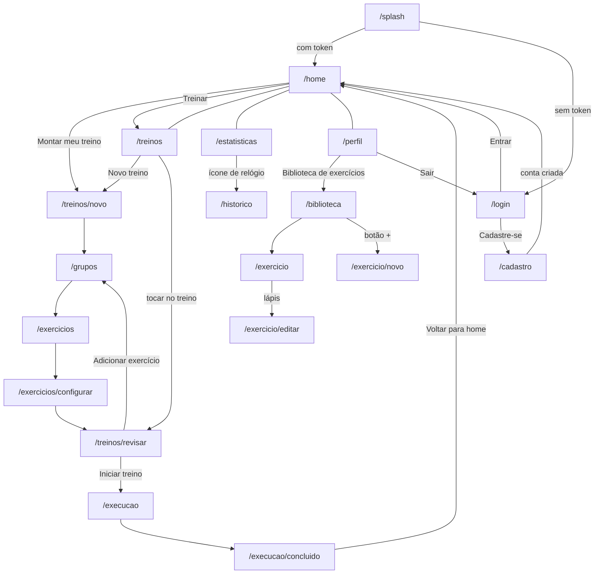

As linhas sem seta (`---`) ligam as quatro **abas**: trocar de aba zera a pilha (`Get.offAllNamed`).

## Splash → Início ou Login

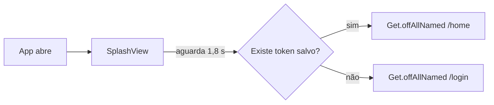

A splash mostra a marca e um indicador de carregamento. Não consulta o servidor: se o token estiver vencido, a primeira chamada autenticada o renova ou, se o *refresh token* também venceu, leva ao login.

## Acesso

### Login

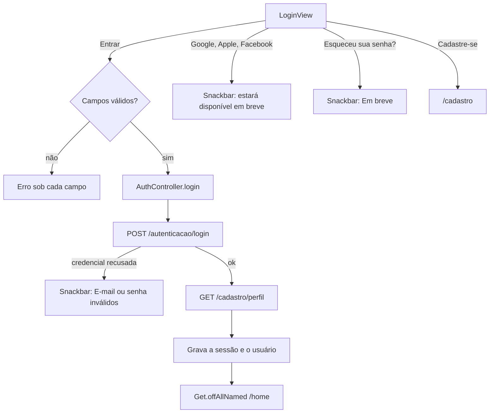

### Cadastro

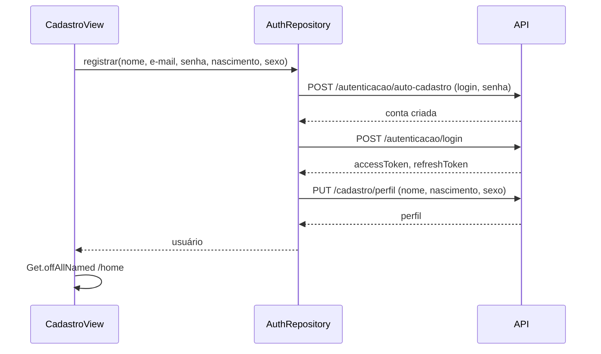

E-mail repetido (409) volta com *"Já existe uma conta com este e-mail."*, sem criar nada.

## Montar um treino

O fluxo central do app. As cinco telas dividem **um** `TreinoFormController`, e a pilha de rotas segue uma disciplina que o diagrama abaixo e a tabela depois dele resumem.

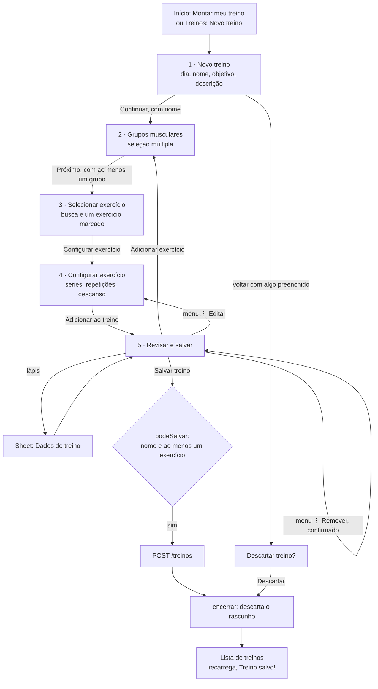

### A pilha de rotas em cada passo

| Passo | Treino novo | Treino que já existe |
|---|---|---|
| Abre | `[…, novo]` (de `/home` ou de `/treinos`) | `[treinos, revisar]` (a revisão é a base) |
| Grupos | `[…, novo, grupos]` | `[treinos, revisar, grupos]` |
| Exercícios | `[…, novo, grupos, exercicios]` | `[treinos, revisar, grupos, exercicios]` |
| Configurar | `[…, novo, grupos, exercicios, configurar]` | `[treinos, revisar, grupos, exercicios, configurar]` |
| Confirma | `offNamedUntil(revisar, até novo)` → `[…, novo, revisar]` | `Get.until(revisar)` → `[treinos, revisar]` |
| Salva | `Get.until(treinos)` (aberto pela lista) ou `offAllNamed(treinos)` (aberto pela Início) | `Get.until(treinos)` |
| Iniciar treino | — (o botão é *Salvar treino*) | `offNamed(execucao)` → `[treinos, execucao]` |

Duas consequências, ambas cobertas por teste ([07-engenharia.md](07-engenharia.md#testes-e-verificação)): a rota base **não é trocada** (a lista só recarrega quando a base sai da pilha), e `encerrar()` roda com as telas ainda animando a saída (por isso elas guardam o controller no `State`, R16).

### Treino que já existe

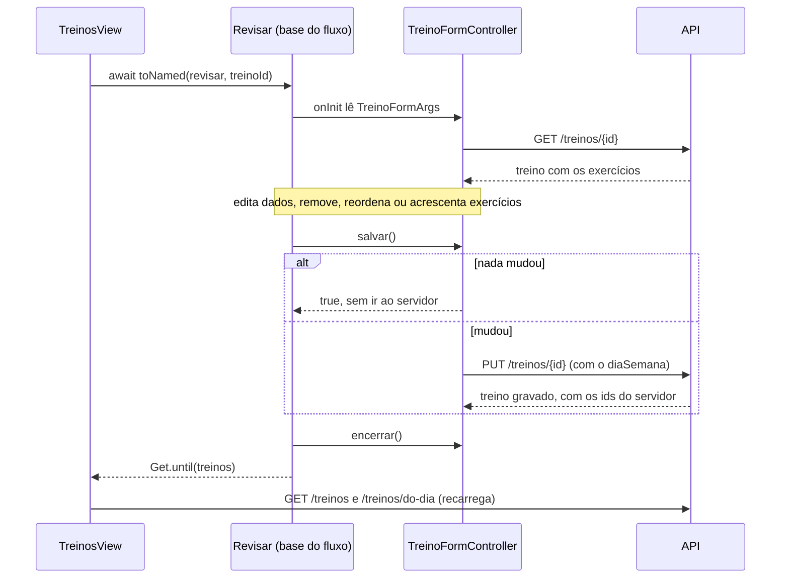

## Meus treinos

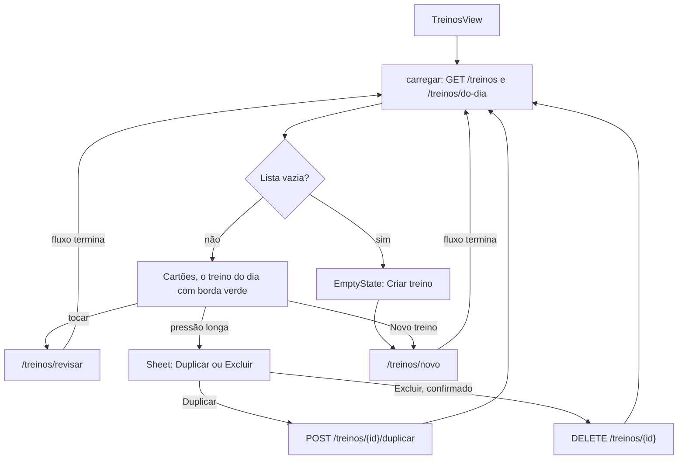

## Execução do treino

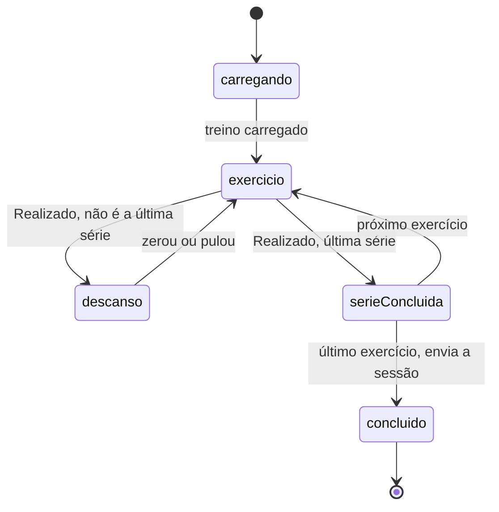

Implementado em [ExecucaoController](../lib/src/core/features/execucao/controller/execucao_controller.dart) e nos três *commands*. A **regra de ouro** — o descanso nunca vem depois da última série de um exercício — é estrutural: só o `ConcluirSerieCommand` atribui `ExecucaoState.descanso`. Os cronômetros, a carga, a retomada e o que vai ao servidor estão em [05-regras-de-negócio.md](05-regras-de-negocio.md#execução-do-treino).

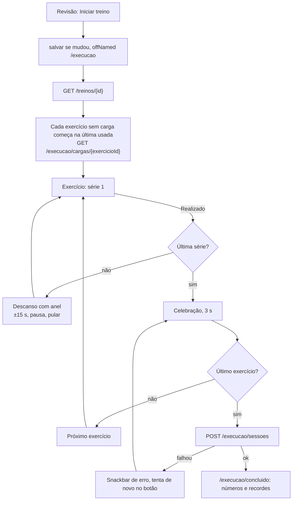

## Sessão e renovação do token

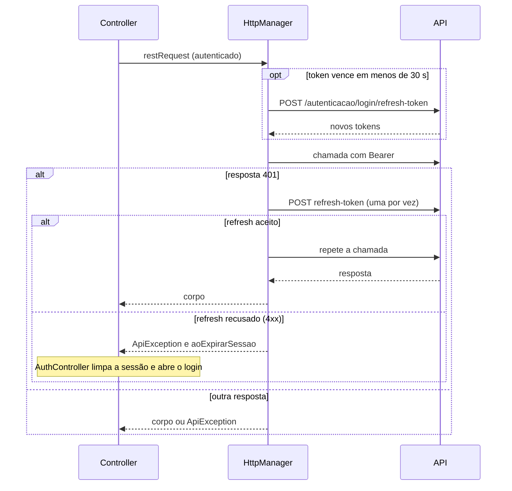

Falha de rede ou 5xx **na renovação** não derruba a sessão: vira `ApiException` e o usuário continua logado.

## Biblioteca de exercícios

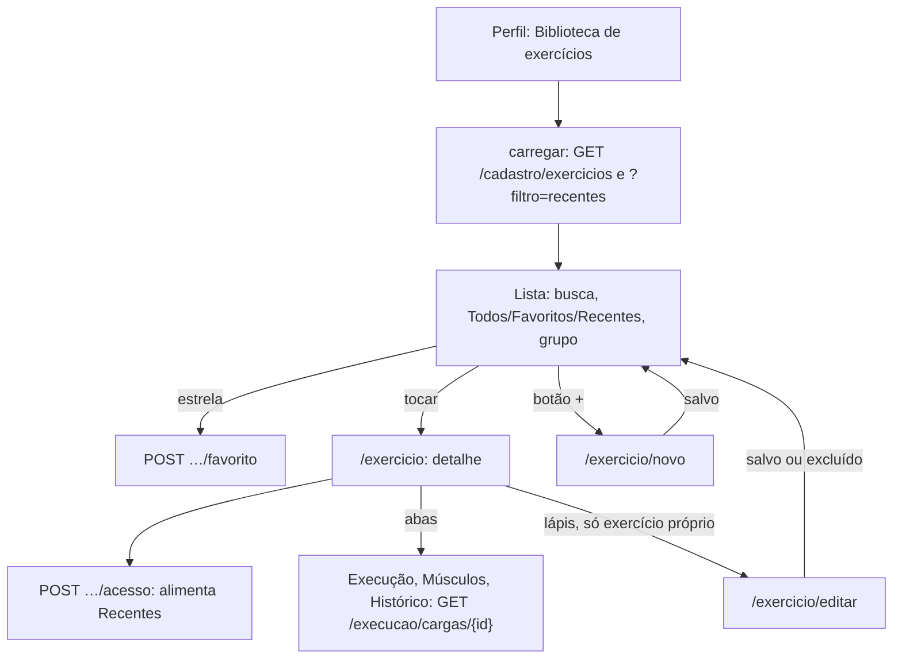

Favoritos, grupo e busca são aplicados **no app**, sobre a lista completa; a ordem de *Recentes* vem da API. Ao voltar do detalhe ou do formulário a lista recarrega sem piscar.

## Evolução e histórico

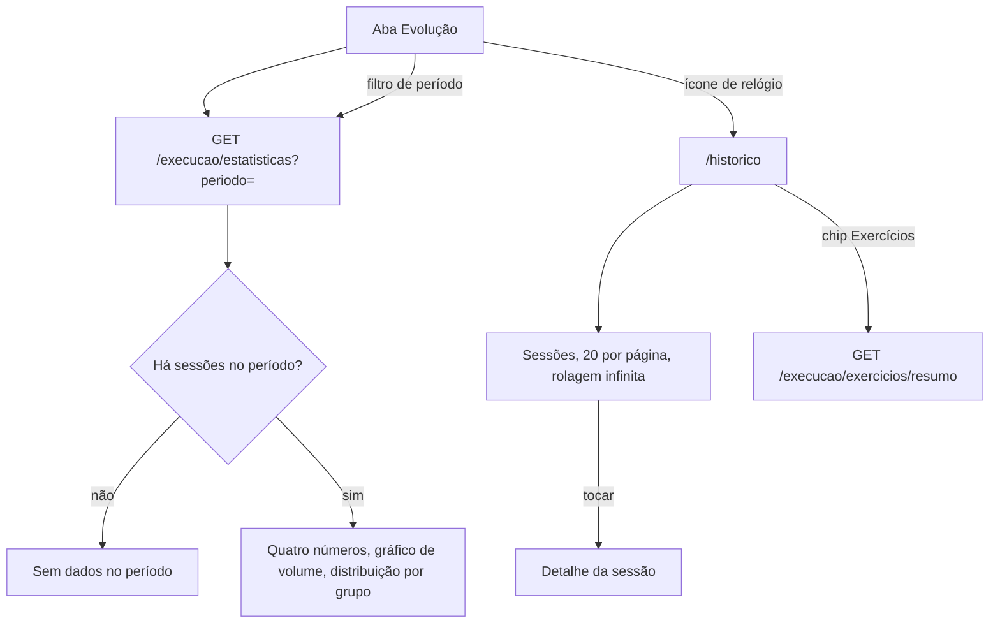

## Erros e log remoto

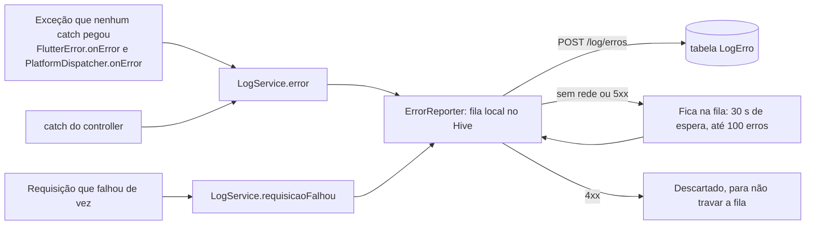

O 401 que a renovação resolve **não** é erro e não vai ao log. Detalhes em [02-arquitetura.md](02-arquitetura.md#erros-e-observabilidade).

## Compartilhamento e recursos adiados

*Compartilhar* o treino concluído, *Fotos de progresso*, a câmera do avatar, *Esqueceu sua senha?* e o login por Google, Apple e Facebook mostram um aviso *"Em breve"*. Não há compartilhamento nem upload em lugar nenhum do app.
